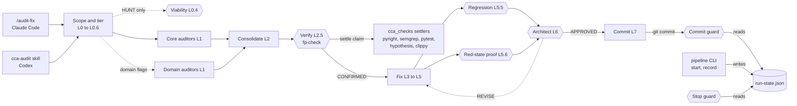

<p align="center">
  <a href="https://github.com/GiulioDER/cca-audit/actions/workflows/ci.yml"></a>
  
  
  <a href="https://github.com/GiulioDER/cca-audit/blob/master/LICENSE"></a>
</p>

# CCA-Audit

A multi-agent code auditor for [Claude Code](https://docs.anthropic.com/en/docs/claude-code) and
Codex. No finding reaches the fix plan until it has been verified against the code.

Eleven specialised auditors read your diff in parallel. Their findings are deduplicated, and each one
is then re-derived from the real code: by `pyright`, `clippy`, `semgrep`, `pytest` or `hypothesis`
wherever a tool can settle the claim, and by adversarial review where none can. Only the findings
that survive are eligible to be fixed. A differential pass then checks the fix for scope creep, and an
architect gate refuses the change unless every confirmed finding has a fix and every edit has a
finding.

Python and Rust have deterministic settlers, and each language gets the claim types that carry
information in it. Rust has no `nullability` claim, because code that compiled has no null pointer to
miss; it has `panic_path`, `overflow` and `error_swallow` instead. A file in any other language, or a
claim type its backend does not declare, escalates to review instead of being settled by a tool built
for something else.

One rule runs through the design: a check that could not run must never look like a check that
passed.

The [documentation map](https://github.com/GiulioDER/cca-audit/blob/master/docs/README.md) is the
shortest path through the docs: install, run, tune, extend, then the design evidence behind each
verifier.

## New in 0.11: every step is gated

In 0.10 the gate required L1, L2, L2.5 and L6, and required the fix layers only when L4 had been
recorded, so an unrecorded L4 switched off L5, L5.5 and L5.6. In 0.11 every layer from L0.4 to L6 is
recorded with `python -m cca_checks pipeline record`, which refuses a layer whose
predecessors are missing or whose counts disagree with the layers before it. A verdict from L5 onward
stores the working tree it judged, so an edit made after the verdict makes it stale.

Two Claude Code hooks enforce the record. The commit guard refuses `git commit` until every layer
the run owes is recorded and L6 reads `APPROVED`. The Stop guard refuses to end the turn while a run
is open, up to three times per run, and then logs `STOPPED_INCOMPLETE`. Codex has no hooks, so its
skill runs `pipeline status --require-complete` before any final summary.

A long run can stop at a layer boundary with `pipeline pause --reason` and continue in a later
session with `pipeline resume`, which prints the next layer, the stored outputs, and whether the tree
changed in between. The full list, including the upgrade steps from 0.10, is in the
[changelog](https://github.com/GiulioDER/cca-audit/blob/master/CHANGELOG.md).

## Verified in the field

Two upstream results, both from [hunt mode](#hunt-mode-auditing-code-you-did-not-write), and both
checkable in under a minute.

### SciPy: merged upstream

Hunt mode was pointed at [scipy/scipy](https://github.com/scipy/scipy) (about 14.8k stars) and found
a copy-paste defect in the complex-coefficient guard of `signal.decimate`:

```python
elif (any(np.iscomplex(system.poles))
      or any(np.iscomplex(system.poles))   # <- should be system.zeros
      or np.iscomplex(system.gain)):
```

> The guard exists to route complex-coefficient filters away from `zpk2sos`, which cannot represent
> them. Because it tested the poles twice and never the zeros, a `dlti` filter with real poles and
> complex zeros was not recognised as complex, was forced through `zpk2sos`, and raised
> `ValueError: complex value with no matching conjugate` on valid input.

| | |
|---|---|
| Submitted upstream | [PR #25654](https://github.com/scipy/scipy/pull/25654), 18 Jul 2026 |
| Merged | 23 Jul 2026 by a SciPy maintainer, approved *"LGTM"* and labelled `defect` |
| What shipped | the one-line fix and my regression test, `test_complex_zeros_real_poles_iir_dlti` |
| Latent for | about 3 years and 3 months, since [gh-17881](https://github.com/scipy/scipy/pull/17881) (Apr 2023) |

gh-17881 was titled *"Fix handling on user-supplied filters in `signal.decimate`"* and added the
complex-filter support. The typo disabled half of that feature: complex poles worked and complex zeros
crashed. It survived review, three years of releases, and the surrounding test suite, which covered
only the working half. On 24 Jul 2026 it was still live in the current release, 1.18.0.

The fix was mine and was merged into a core scientific library after maintainer review. It was not
submitted autonomously. SciPy's
[AI policy](https://github.com/scipy/scipy/blob/main/doc/source/dev/conduct/ai_policy.rst) requires
a human to check generated code and open the PR, and requires the PR prose to be the contributor's
own words. I followed both rules, and the PR body discloses the AI assistance.

### Polymarket py-sdk: reported, fixed by the maintainers

Hunt mode was pointed at [Polymarket/py-sdk](https://github.com/Polymarket/py-sdk), an actively
maintained third-party SDK with about 70 stars, and found a client-side price-validation defect:

> `_resolve_price` and `_resolve_protected_market_price` validated prices by decimal-place count
> rather than tick-grid membership. The two agree on power-of-ten ticks and diverge on `0.005`
> and `0.0025` markets, where a price like `0.007` has three decimals, passes validation, is signed
> into the EIP-712 order, and is only then rejected by the exchange.

| | |
|---|---|
| Reported upstream | [issue #162](https://github.com/Polymarket/py-sdk/issues/162), 14 Jul 2026 |
| Fixed upstream | [PR #181](https://github.com/Polymarket/py-sdk/pull/181), merged 21 Jul 2026, body states *"Fixes #162"* |
| Author of the fix | a Polymarket maintainer, independently |
| Issue status | closed as completed |

Here a Polymarket maintainer wrote the fix. The outside report was specific enough for the
maintainers to implement and ship it themselves.

`/audit-fix hunt` surfaced four candidates. The adversarial 2-of-3 verifier rejected the most
striking one, which an open upstream PR already fixed, and one finding that was deliberate by design.
The survivor was reproduced against about 23,000 exhaustive price and tick cases before a line was
written.

Neither result was picked from a benchmark. Both targets were third-party repositories I did not
write, and both findings passed the same adversarial gate before they left the machine.

## It audits itself, and the self-audit finds things

The substrate-differential design slice shipped through five task reviews and a whole-branch review.
CCA was then pointed at it and found two Critical defects that every one of those reviews had missed:

- CI had never executed the feature's test suite. The workflow installed an extra that omitted
  `mpmath`, and both test files `importorskip` it, so about 25 tests skipped silently on all four
  Python versions, including the integrity gate that is the feature's central safety guarantee.
  `2 skipped` became `31 passed`.
- One environment variable made correct code confirm as defective. `CCA_SUBSTRATE_TOL=1e-20` drove
  the deliberately correct test fixture to raise a violation at a measured relative error of `8.3e-18`,
  which is ordinary float64 noise. That verdict would have been binding: protected from being
  overturned, exempt from the adversarial panel, and fed into an automated fix plan.

Both were confirmed by execution rather than by re-reading, and both now carry red→green regression
tests. The full round is [PR #22](https://github.com/GiulioDER/cca-audit/pull/22).

## What is different

Multi-agent review is common. These parts are less so.

**A tool settles the claim where one can.** Each finding is classified into a claim type and settled
by the tool that can decide it: `pyright` for definedness, nullability and type, `semgrep` for taint,
a `pytest` repro for crash impact, and `hypothesis` for arithmetic. The verdict carries a
machine-produced artifact, and an LLM may not overturn it. The LLM adjudicates only what no tool
could settle.

**Each verdict claims only what its evidence supports.** `semgrep` can prove a sink is absent but
can never prove an injection is real. The numeric checker can confirm with a falsifying example but
can never refute, because a property that held across a bounded search only shows that no
counterexample was found. A clean run returns `UNCERTAIN`.

**The fix is audited too.** After the fixes land, a differential pass checks that each hunk maps to
its finding and changes no behaviour beyond it. Scope creep and regression risk go back for repair.
A red-state proof then reverts each fix and re-runs its test, and a test that passes on the old code
too is reported as tautological instead of being counted as proof.

**Every fix maps to a finding.** The architect gate emits a table showing that every confirmed
finding has a fix and every edit traces to a finding. An orphan finding or a phantom edit forces
REVISE.

**The risk picks the tier, not the user.** Trivial diffs run cheaply. Diffs touching money, auth or
numeric code are forced to the full adversarial treatment, so declaring a change safe does not buy a
lighter review.

## Honest limits

A verification tool that cannot say where it is blind asks for trust it has not earned. Most of the
limits below are asserted by tests.

- **The numeric substrate check cannot see sign or formula errors.** Its two substrates differ in how
  they evaluate and agree in what they evaluate: both compute whatever structure was written down,
  so a flipped sign survives into both and they agree. That class belongs to the property helpers.
  `test_sign_trap_does_not_violate` asserts this.
- **Its provenance gate observes Python conversion hooks, not every native intermediate.** An `mpf`
  converted through `__float__`, `__int__` or `__complex__` in a helper module returns `UNCERTAIN`,
  even when outer arithmetic promotes the float back to `mpf`. Native code that extracts a value
  without those hooks, and work delegated to another thread, remain unsupported.
- **Its replay screens for state but does not prove purity.** The float64 result is evaluated before
  and after the reference run, and a mismatch returns `UNCERTAIN`. That closes the false confirmation
  demonstrated with a counter-based target, but a finite replay cannot certify an arbitrary function
  as free of side effects.
- **The agent that raised a finding also writes its property.** A wrongly declared relation therefore
  produces a real counterexample to a wrong claim. A confirmation obliges you to re-read the relation
  as well as the verdict.
- **Deterministic coverage is per language, and a language without a backend gets none.**
  `python -m cca_checks capabilities --file <F>` reports what the tool can settle on your machine,
  including which tools are missing, so ask it rather than trusting this table.

  | | settled deterministically | by |
  |---|---|---|
  | **Python** | `definedness` · `nullability` · `type` · `taint` · `clock_leak` | `ast` + `pyright` + `semgrep` |
  | **Rust** | `clock_leak` · `panic_path` · `overflow` · `error_swallow` · `unsafe_op` · `taint` | tree-sitter + `clippy` + `semgrep` |
  | **everything else** | nothing; every claim escalates to LLM adjudication | no tool |

  A claim about a file no backend covers, or a claim type the covering backend does not declare,
  returns `UNCERTAIN` before any checker runs, so a tool built for another language cannot refute it.
  `test_language_guard.py` asserts this for every claim type.

- **Rust has no `definedness`, `type` or `nullability` claims, by design.** Those defects do not
  survive to review in code that compiled: the name resolved, the types checked, and `Option` is not
  a nullable pointer. Porting them would have doubled the claim vocabulary while refuting almost
  everything by construction.
- **The Rust clock check reads syntax, not semantics.** tree-sitter does not expand macros, so it
  cannot see a clock read inside a `macro_rules!` body or one reaching the file through a glob `use`.
  Both block refutation instead of being ignored: a file must not earn a `FALSE_POSITIVE` with an
  authoritative `source` just by being hard to read. `test_clock_check_rust.py` asserts both.
- **clippy needs the crate to build.** A crate that does not compile produces no lint diagnostics,
  which looks exactly like a clean crate. An unbuildable crate is therefore `UNCERTAIN` everywhere and
  never refuted. `test_clippy_check.py::test_a_stream_that_proves_nothing_returns_none` asserts the
  whole cascade.
- **A debug test cannot prove release-mode wrapping overflow.** Rust panics on overflow in debug
  builds and wraps silently in release builds, and a `cargo test` artifact can only demonstrate the
  first. The second is the more dangerous half, and it is disclosed rather than claimed.
- **clippy can never confirm a `panic_path` or `unsafe_op` finding.** A lint sees the construct, not
  whether a value the caller controls can reach it: `.unwrap()` on a value built two lines above is
  correct code. Like `taint`, these two refute a false premise and inform adjudication, and a
  confirmation has to come from a repro that actually panics.
- **The commit guard does not inspect command substitution or `$'...'` quoting.** A command such as
  `git commit -am "$(<edit>)msg"` runs the edit before git and commits it unjudged. Both gaps were
  parked after three repair cycles each, and the
  [changelog](https://github.com/GiulioDER/cca-audit/blob/master/CHANGELOG.md) records where a fix
  should start.

## Pipeline

<p align="center">
  <a href="https://github.com/GiulioDER/cca-audit/blob/master/docs/diagrams/README.md">
    <picture>
      <source media="(prefers-color-scheme: dark)" srcset="https://raw.githubusercontent.com/GiulioDER/cca-audit/master/docs/diagrams/cca-overview-dark.png">
      
    </picture>
  </a>
</p>

Every layer from L0.4 to L6 is recorded with `python -m cca_checks pipeline record`, and the commit
guard refuses `git commit` until every layer the run owes is recorded and L6 reads `APPROVED`. The
[interactive version](https://github.com/GiulioDER/cca-audit/blob/master/docs/diagrams/README.md)
links each box to the source lines it describes.

<details>
<summary>Text version of the diagram</summary>



</details>

FAST runs three core auditors and skips the scorecard, the regression diff and the red-state proof,
but it still verifies every P1 before fixing it. On every tier, no finding is edited into your code
unverified.

## The auditors

Each auditor has its own scope, and the scopes do not overlap, so findings do not duplicate and no
auditor rules on another's domain.

**Core** (FAST runs only the first three):

| Auditor | Scope | Does NOT check |
|---------|-------|----------------|
| **Security** *(single authority)* | OWASP Top 10, injection, auth, secrets, CVEs | Runtime bugs, code quality |
| **Bug** | Null refs, error handling, races, resource leaks | Security, style |
| **Code Quality** | Type safety, DRY, complexity, naming, dead code | Security, runtime, performance |
| **Performance** | Slow queries, hot paths, memory, pooling | Security, style |
| **Documentation** | Missing docs, stale comments contradicting new code | TODOs, debug statements |
| **Environment** | Config completeness, format validation, naming | Secrets *(Security owns those)* |

**Conditional**, dispatched only when the diff touches their concern:

| Auditor | Runs when | Checks |
|---------|-----------|--------|
| **High-Stakes / Safety** | money, auth, delete or irreversible paths | Bounds, guards, kill-switches, idempotency |
| **Numerical / Units** | non-trivial arithmetic | Sign, units, scaling, rounding, conversions |
| **Data-Integrity** | migrations, SQL, schema | Migration and grant, type assumptions, safe accessors |
| **Dependency** | a manifest or lockfile changed | Maintenance health, licences, unused deps, pin breakers |
| **Deployability** | deployable code, units or migrations | Generated files, pin and lock breakers, service↔scheduler pairing, deploy-target assumptions |

Plus the verification agents: **fp-check** (anti-hallucination), **differential-review**
(anti-regression), and the read-only **architect-reviewer** final gate.

## Hunt mode: auditing code you did not write

`/audit-fix` reviews your own diff. Hunt mode points the same pipeline at a codebase you did not
write, such as a dependency, a repository you are evaluating, or a legacy service, to find defects
that are already there:

```
/audit-fix hunt src/payments        # a whole subtree, no diff required
/audit-fix hunt path/to/file.py     # or specific files
```

Run hunt mode on third-party code in a disposable sandbox, because the deterministic layer can
execute the audited repository's tests and imports. The
[Security Policy](https://github.com/GiulioDER/cca-audit/blob/master/SECURITY.md) has the threat
model and the mitigation.

Hunt mode changes four things:

- It audits whole files. *"Pre-existing bugs are the target"* replaces *"only audit the diff"*,
  because old code is not evidence of correct code.
- A target-viability check runs before any auditor is spawned. It asks whether the repository is
  alive, accepts contributions, has a test harness, and is written in a language this pipeline audits
  well. An archived or deprecated repository is rejected at once, since a fix there can never be
  merged.
- The tier is forced to DEEP. P1 and P2 findings are verified, high-stakes P1s without a tool artifact
  go to the adversarial 2-of-3 verifier, and a `NUM-*` P1 needs a `hypothesis` artifact before it can
  enter the fix plan.
- L2.5 searches the target's own issues and PRs, and drops a bug someone already reported as
  `DUPLICATE` instead of reporting it again.

A finding that comes out of hunt mode has been reproduced with a failing test, is not already known
upstream, and has survived adversarial review. That process produced both
[field results](#verified-in-the-field) above: the merged SciPy fix and the Polymarket report.

## Install

### Codex

```bash
pip install cca-audit
cca-audit install-codex
```

This installs the `cca-audit` skill in the Codex user skills directory. Start a new Codex task, open
the project you want to audit, and say `audit+fix`. Codex runs the canonical pipeline in that task
with parallel subagents, keeping at most six open at once. Reinstalling upgrades the adapter, the
auditor prompts and the checker scripts, and keeps any file you customized as a `.bak` copy.

### Claude Code

```bash
pip install cca-audit
cca-audit install          # run from the root of the project you want to audit
```

This copies the auditor agents into `.claude/agents/`, `/audit-fix` into `.claude/commands/`, the
checker tools into `.claude/tools/` and the two guards into `.claude/hooks/`. It also puts the
`cca_checks` verifier (`python -m cca_checks`) on the same interpreter. Re-run `cca-audit install` to
upgrade; a file you have customized is kept as `<name>.md.bak` instead of being overwritten.

The guards do nothing until you register them. `cca-audit install --print-hook` prints the
settings.json fragment for both hooks, and it only prints: you add the fragment to your settings
yourself. Upgrading from 0.10, run `cca-audit install` first and replace both hook entries second. A
Stop hook registered before its script exists refuses every turn end, and the commit guard's timeout
is now 60 seconds instead of 15.

<details>
<summary>Install without pip (shell script, requires git)</summary>

```bash
# Unix/macOS
curl -fsSL https://raw.githubusercontent.com/GiulioDER/cca-audit/master/claude-code/install.sh | bash
```

```powershell
# Windows PowerShell
irm https://raw.githubusercontent.com/GiulioDER/cca-audit/master/claude-code/install.ps1 | iex
```

These clone the repository to a temporary directory and copy the agents, the command and the tools.
They do not install the guards; use `cca-audit install` for those. Both paths read the markdown from
`cca_checks/plugin/`, so there is one copy on disk and they cannot drift.
</details>

For the deterministic verification layer, put `pyright`, `pytest` and `semgrep` on your `PATH`.
Without them, the `definedness`, `nullability`, `type` and `taint` claim types fall back to LLM-only
verification, without a crash or a regression.

`numeric` is the exception, because it fails closed instead of falling back. On DEEP, a `NUM-*` P1
may not enter the fix plan on an LLM-sourced verdict: it carries a Hypothesis artifact or it is
escalated as `UNCERTAIN`. DEEP is forced for every high-stakes or numeric diff and for all of hunt
mode, so **without the `numeric` extra, arithmetic findings on money-path code cannot be auto-fixed
at all.** That is deliberate, since a sign error reads fluently and a second LLM opinion is not
evidence, but it is a hard stop rather than a graceful degradation.

The extras provide the tools:

```bash
pip install 'cca-audit[verify]'    # the deterministic layer, except taint
pipx install semgrep               # taint checking, isolated, see below
pip install 'cca-audit[numeric]'   # just hypothesis + mpmath + pytest
pip install 'cca-audit[rust]'      # just the tree-sitter Rust grammar
```

From a clone, the editable equivalents are `pip install -e ".[verify]"` and `-e ".[numeric]"`.

semgrep is installed separately because of its pins. `cca_checks` never imports semgrep; it finds
it on PATH and runs it, as it does `cargo`. semgrep pins `mcp==1.29.0`, `ruamel.yaml.clib` and
`pywin32` exactly, so including it in `verify` let `pip install 'cca-audit[verify]'` downgrade
packages that have nothing to do with auditing. `pipx` gives semgrep its own environment and puts the
binary on PATH, which is all this package needs. If you would rather share one environment and
accept those pins, `pip install 'cca-audit[taint]'` does that.

The `verify` extra still installs `pyright` through pip, which brings no such pins. The Rust
toolchain is different again: `cargo` and `clippy` belong to the project you are auditing and are not
pip extras. `python -m cca_checks capabilities --file <a source file>` reports what you have. It
probes each tool by running it, so a tool that is on PATH but cannot execute is reported with its
reason instead of being counted as present.

Worked example: [`examples/sign-trap`](https://github.com/GiulioDER/cca-audit/tree/master/examples/sign-trap),
a real sign error, the property that catches it, and the resulting artifact.

## Usage

In Codex, use the phrase form:

```text
audit+fix
audit+fix deferred
audit+fix no-fix
audit+fix p1-only
audit+fix fast
audit+fix deep commit 3
audit+fix files src/app.py
audit+fix hunt src/
```

In Claude Code, use the command form:

```
/audit-fix                 # audit + fix uncommitted changes (tier auto-selected)
/audit-fix deferred        # second pass: fix P3 items deferred by the previous round
/audit-fix no-fix          # audit + verify only
/audit-fix p1-only         # fix only P1 Critical findings
/audit-fix fast | deep     # override the auto-selected tier
/audit-fix commit 3        # audit the last 3 commits
/audit-fix files src/app.py
/audit-fix hunt src/       # audit code you did NOT write
```

The pipeline picks the tier, so you normally do not.

| Tier | When (auto) | Auditors | Verification gates | P1 fix style |
|------|-------------|----------|--------------------|--------------|
| **FAST** | trivial, low-stakes, non-deploy diff | 3 core | L2.5 on P1 only | direct |
| **STANDARD** | normal diff | all 6 core + conditional | L2.5, L5.5, L5.6 and the fix mapping | red→green test |
| **DEEP** | high-stakes, numeric, hunt or forced | all of STANDARD | STANDARD plus adversarial 2-of-3 on high-stakes P1 | red→green test |

| Priority | Criteria | Action |
|----------|----------|--------|
| **P1 Critical** | Security, data corruption, auth bypass, injection, unsafe money or irreversible handling | Fix before deploy, with a red→green test |
| **P2 High** | DRY divergence, stale misleading comments, config inconsistencies, unit mismatches | Fix now |
| **P3** | Cosmetic, style, naming, unused params | Deferred to round 2 |

Round 2 (`/audit-fix deferred`) reads the deferred list from the previous commit, re-checks that each
item still applies, fixes what remains and marks the rest stale, so no audit leaves a tail.

A run can be paused between layers and resumed in a later session:

```bash
python -m cca_checks pipeline pause --reason "stopping for the day"
python -m cca_checks pipeline resume
```

While a run is paused, `record`, `close` and `git commit` are refused, and `pipeline abort --reason`
still works.

## Engineering

| | |
|---|---|
| Tests | 946 collected, run in CI on every push and PR |
| Python | 3.10, 3.11, 3.12 and 3.13, the full matrix in CI |
| Packaging | wheel built and smoke-installed into a clean venv in CI |
| Lint | `ruff`, zero warnings |
| Types | `pyright` |
| Design of record | [`docs/v3-design.md`](https://github.com/GiulioDER/cca-audit/blob/master/docs/v3-design.md), versioned slices v3.0 to v3.6 |

Every deterministic-verification slice ships with a written spec and an implementation plan under
[`docs/superpowers/`](https://github.com/GiulioDER/cca-audit/tree/master/docs/superpowers). They
include the measured dead ends, approaches that were tried and failed, so nobody attempts them again.

## Documentation

- [Documentation map](https://github.com/GiulioDER/cca-audit/blob/master/docs/README.md): install, pipeline, configuration, extension and design evidence
- [Security Policy](https://github.com/GiulioDER/cca-audit/blob/master/SECURITY.md): **this tool executes code from the repository under audit**
- [Changelog](https://github.com/GiulioDER/cca-audit/blob/master/CHANGELOG.md) · [Contributing](https://github.com/GiulioDER/cca-audit/blob/master/CONTRIBUTING.md)

Articles:

- [Fluency isn't evidence](https://github.com/GiulioDER/cca-audit/blob/master/docs/blog-fluency-isnt-evidence.md): why a sign error survives review, and how a counterexample settles it
- [Why AI code review hallucinates](https://github.com/GiulioDER/cca-audit/blob/master/docs/blog-why-ai-review-hallucinates.md), and the two gates that close it
- [The benchmark memorization gap](https://github.com/GiulioDER/cca-audit/blob/master/docs/blog-benchmark-memorization-gap.md): what a passing benchmark score measures

## Acknowledgements

The substrate-differential check in [`cca_checks/substrate.py`](https://github.com/GiulioDER/cca-audit/blob/master/cca_checks/substrate.py)
began as a suggestion from Erik Hill (AgentDev9 on dev.to, [@egnaro9](https://github.com/egnaro9),
[egnaro9.github.io](https://egnaro9.github.io)) in a public comment thread on differential checking
for numeric code. He argued for running the same numeric rule under two arithmetics and letting the
substrates disagree where an author cannot, and he pressed specifically on float64 versus exact
rational, the tradeoff that module now documents at length. The idea is his, offered freely in review
with nothing asked in return. The implementation, the measured rejection of `Fraction` and
`Decimal`, and the integrity gate are mine.

## License

[MIT](https://github.com/GiulioDER/cca-audit/blob/master/LICENSE)
