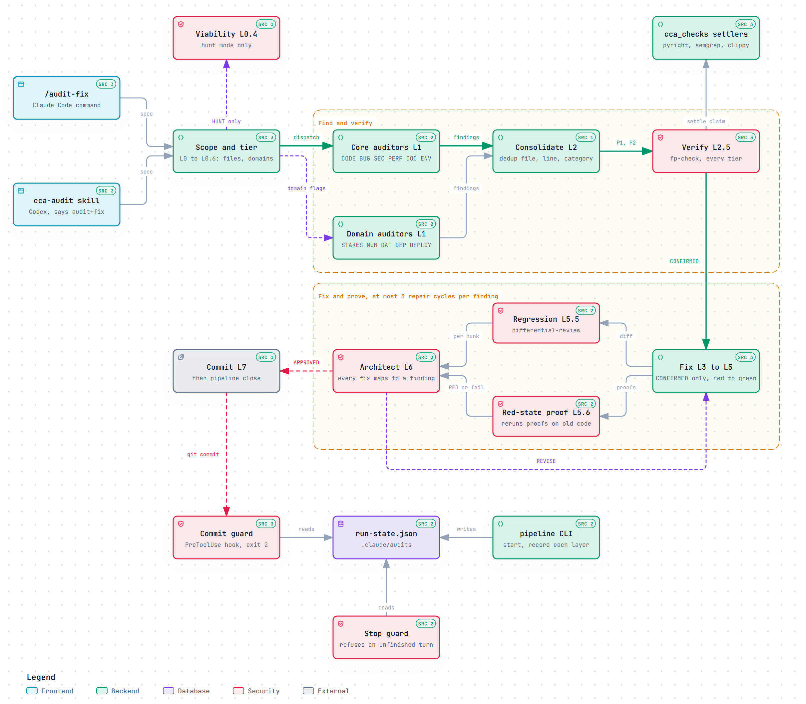

<p align="center">
  <a href="https://github.com/GiulioDER/cca-audit/actions/workflows/ci.yml"></a>
  
  
  <a href="https://github.com/GiulioDER/cca-audit/blob/master/LICENSE"></a>
</p>

# CCA-Audit

AI code review that proves its findings, fixes them, confirms no new bugs were introduced, and ends with a final review.

Agentic reviewers and deterministic tools check each other, and every layer runs as a separate agent that sees only the previous layer's output, never its reasoning.

## Why

Most AI code reviewers give you a list of plausible findings and leave you to sort out which are
real. CCA-Audit, a multi-agent auditor for
[Claude Code](https://docs.anthropic.com/en/docs/claude-code) and Codex, does that sorting before
you see the list. No finding reaches the fix plan until it has been verified against the code, and
no commit goes through until every fix has been checked. I use it a lot to speed up coding with
agents: the agent writes the code, CCA checks it, and the findings I read have already been checked
against the code.

## How it works

Eleven specialised auditors read your diff in parallel, each in its own scope. Every finding then
goes through four steps:

1. **Prove.** Each finding is re-derived from the code: by `pyright`, `clippy`, `semgrep`, `pytest`
   or `hypothesis` where a tool can settle it, and by adversarial review where none can. An LLM may
   not overturn a tool verdict. A verdict claims only what its evidence supports: `semgrep` can
   prove a sink absent, never an injection real, and a clean property search returns `UNCERTAIN`,
   not "correct".
2. **Fix.** Only the findings that survived are fixed.
3. **Check for new bugs.** Each hunk must map to its finding, or it is flagged as scope creep. A
   red-state proof reverts each fix and re-runs its test; a test that passes on the old code is
   reported as tautological.
4. **Final review.** The architect gate refuses the change unless every confirmed finding has a fix
   and every edit has a finding. A commit guard refuses `git commit` until the run is complete and
   the architect reads `APPROVED`.

Risk picks the tier, not the user: diffs touching money, auth or numeric code are forced to the full
adversarial path. The design rule: a check that could not run must never look like a check that
passed.

<p align="center">
  <a href="https://github.com/GiulioDER/cca-audit/blob/master/docs/diagrams/README.md">
    <picture>
      <source media="(prefers-color-scheme: dark)" srcset="https://raw.githubusercontent.com/GiulioDER/cca-audit/master/docs/diagrams/cca-overview-dark.png">
      
    </picture>
  </a>
</p>

## Results on code I did not write

**SciPy, merged.** Hunt mode found a copy-paste defect in `signal.decimate`: the complex-filter guard
tested `system.poles` twice and never `system.zeros`, so a filter with complex zeros crashed with
`ValueError` on valid input. Latent for three years. Fixed in
[scipy/scipy#25654](https://github.com/scipy/scipy/pull/25654), merged 23 Jul 2026 with my
regression test. I opened the PR myself under SciPy's AI policy and disclosed the assistance.

**Polymarket py-sdk, fixed by the maintainers.** Price validation counted decimal places instead of
checking tick-grid membership, so on `0.005` markets a price like `0.007` was signed and then
rejected by the exchange. Reported in
[Polymarket/py-sdk#162](https://github.com/Polymarket/py-sdk/issues/162) and fixed in
[#181](https://github.com/Polymarket/py-sdk/pull/181). Of four candidates, the adversarial verifier
rejected two; the survivor was reproduced on about 23,000 price and tick cases first.

Pointed at its own code, CCA found that CI had silently skipped about 25 tests on every Python
version ([PR #22](https://github.com/GiulioDER/cca-audit/pull/22)).

## Memory across audits

CCA keeps what its runs settled and hands it back through
[RE-call](https://github.com/GiulioDER/RE-call), matched to code by file, symbol and a hash of the
code. Bugs it already fixed at the code a change touches go to every auditor before the audit. A
false alarm the verifier already rejected on the same code is marked `PRIOR_FP` and listed with its
citation, never dropped; a high-stakes finding is never suppressed. Fixes are recorded in an append
only ledger in `~/.claude/cca-bugs/` once their pull request merges.

Memory is optional: without a `recall-cca` server, audits run as before. A hunt never reads memory
from your own projects. Whether memory raises the number of real findings is not established: a
pre-registered replay of eight past runs (2026-10-20 and 21) found a difference within run to run
noise
([record](https://github.com/GiulioDER/cca-audit/blob/master/docs/preregistrations/2026-10-20-prior-bugs-rule-and-noise.md)),
and the anchored brief, `PRIOR_FP` and lessons are not measured.

## The auditors

Scopes do not overlap, so findings do not duplicate
([boundaries](https://github.com/GiulioDER/cca-audit/blob/master/docs/auditor-scopes.md)).

**Core** (FAST runs the first three):

| Auditor | Checks |
|---------|--------|
| **Security** | OWASP Top 10, injection, auth, secrets, CVEs |
| **Bug** | null refs, error handling, races, resource leaks |
| **Code Quality** | type safety, duplication, complexity, dead code |
| **Performance** | slow queries, hot paths, memory, pooling |
| **Documentation** | missing docs, comments the new code contradicts |
| **Environment** | config completeness and format |

**Conditional**, dispatched when the diff touches their concern:

| Auditor | Runs when |
|---------|-----------|
| **High-Stakes / Safety** | money, auth, delete or irreversible paths |
| **Numerical / Units** | non-trivial arithmetic |
| **Data-Integrity** | migrations, SQL, schema |
| **Dependency** | a manifest or lockfile changed |
| **Deployability** | deployable code, units or migrations |

Plus the verification agents: **fp-check**, **differential-review** and the read-only
**architect-reviewer**.

## Install

```bash
pip install cca-audit
cca-audit install-codex    # Codex: installs the skill; then say "audit+fix" in a task
cca-audit install          # Claude Code: run from the root of the project to audit
```

For Claude Code, `cca-audit install --print-hook` prints the settings.json fragment for the commit
and Stop guards. They do nothing until you add it.

The deterministic layer needs its tools on `PATH`:

```bash
pip install 'cca-audit[verify]'    # pyright, pytest
pipx install semgrep               # taint; kept apart because semgrep pins unrelated packages
pip install 'cca-audit[numeric]'   # hypothesis, mpmath
pip install 'cca-audit[rust]'      # tree-sitter Rust grammar; cargo and clippy come from your toolchain
pip install 'cca-audit[typescript]'  # tree-sitter TypeScript grammar, for spans
npm install -g typescript@6.0.3      # the compiler for TypeScript claims; needs node
```

Missing tools fall back to LLM verification, with one exception: **without the `numeric` extra,
arithmetic findings on high-stakes code cannot be auto-fixed.** To see what your machine can settle:

```bash
python -m cca_checks capabilities --file <source file>
```

## Usage

```
/audit-fix                 # audit and fix uncommitted changes
/audit-fix no-fix          # audit and verify only
/audit-fix p1-only         # fix only critical findings
/audit-fix fast | deep     # override the tier
/audit-fix commit 3        # audit the last 3 commits
/audit-fix files src/app.py
/audit-fix hunt src/       # find existing bugs in code you did not write
/audit-fix deferred        # gated pass over what the last run deferred
```

In Codex, drop the slash: `audit+fix`, `audit+fix hunt src/`.

| Tier | Selected for | Verification |
|------|--------------|--------------|
| **FAST** | trivial, low-stakes diffs | 3 auditors; P1 findings verified |
| **STANDARD** | normal diffs | all auditors, regression diff, red-state proof |
| **DEEP** | money, auth, numeric, hunt | STANDARD plus 2-of-3 adversarial review |

P1 findings are fixed with a red→green test, P2 are fixed now, P3 are deferred to an optional gated
pass. Hunt mode executes the audited repository's tests and imports, so run it on third-party code
in a sandbox. See the [Security Policy](https://github.com/GiulioDER/cca-audit/blob/master/SECURITY.md).

## Limits

- Deterministic coverage exists for Python, Rust and TypeScript (for TypeScript, `definedness`,
  `type` and `nullability` only). Other languages get LLM review, and an uncovered claim returns
  `UNCERTAIN` rather than being settled by the wrong tool.
- The numeric substrate check cannot see a sign or formula error that both arithmetics compute alike.
- A crate that does not build gives clippy nothing to check, so it is `UNCERTAIN` everywhere.
- The commit guard reads bash and PowerShell closely, not exactly: a few constructs that commit
  in an open run's checkout are still let through.

The full list, with the test that asserts each one, is in
[docs/limits.md](https://github.com/GiulioDER/cca-audit/blob/master/docs/limits.md).

## Engineering

| | |
|---|---|
| Tests | 1114 passed, in CI on Python 3.10 to 3.13 |
| Lint and types | `ruff`, `pyright` |
| Design of record | [`docs/v3-design.md`](https://github.com/GiulioDER/cca-audit/blob/master/docs/v3-design.md) |

## Documentation

- [Documentation map](https://github.com/GiulioDER/cca-audit/blob/master/docs/README.md): pipeline, auditor scopes, configuration, extension, design evidence
- [Changelog](https://github.com/GiulioDER/cca-audit/blob/master/CHANGELOG.md) · [Contributing](https://github.com/GiulioDER/cca-audit/blob/master/CONTRIBUTING.md)
- Articles: [Fluency isn't evidence](https://github.com/GiulioDER/cca-audit/blob/master/docs/blog-fluency-isnt-evidence.md) · [Why AI code review hallucinates](https://github.com/GiulioDER/cca-audit/blob/master/docs/blog-why-ai-review-hallucinates.md) · [Your AI code reviewer's benchmark is memorized](https://github.com/GiulioDER/cca-audit/blob/master/docs/blog-benchmark-memorization-gap.md)

## Acknowledgements

The substrate-differential check in
[`cca_checks/substrate.py`](https://github.com/GiulioDER/cca-audit/blob/master/cca_checks/substrate.py)
began as a suggestion from Erik Hill ([@egnaro9](https://github.com/egnaro9)) in a public review
thread: run the same numeric rule under two arithmetics and let them disagree where an author cannot.
The idea is his; the implementation is mine.

## License

[MIT](https://github.com/GiulioDER/cca-audit/blob/master/LICENSE)
